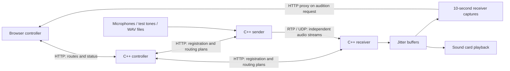

# OpenAoIP

A C++20 prototype of an open-source audio-over-IP system with native Windows Controller, Virtual Soundcard and Audio Bridge applications, dedicated sender/receiver modes and multiple audio streams.

**Version 0.6 provides three separate native Windows applications:** Controller, Virtual Soundcard and Audio Bridge. The Controller has a compact per-channel matrix, search, aliases and routing presets. Bridge connects multiple WASAPI capture/loopback/playback endpoints with channel patches, meters, resampling, adaptive drift buffers and device reconnection. VSC retains the existing x64 ASIO driver and experimental WDM backend. Bridge and VSC share a headless per-user engine. Individual installers, a Suite installer and portable packages are provided. See the German [Windows guide](./WINDOWS-START.md) and [module architecture](./ARCHITECTURE.md).

**Version 0.6.3 couples the network audio rate to PTP.** An explicit software GM and E2E follower share one clock per engine. A bounded frequency servo paces TX/RX; continuous SRC joins WASAPI, ASIO and experimental WDM clock domains. Holdover preserves the last applied rate across reference loss. This is software frequency discipline, with no shared presentation epoch, hardware clock or sample/phase lock. See [PTP setup and validation](./PTP.md). WDM remains an unvalidated kernel prototype; regular installers do not install it or change Windows security. See [Windows audio](./WINDOWS-AUDIO.md).

The legacy CLI/browser controller and physical soundcard endpoints are retained. See the [network quick start](./NETZWERK-START.md). Runtime executables use the static C++ runtime; endpoint PCs need no Node.js or compiler.
Project repository: [Block361/AudioTools](https://github.com/Block361/AudioTools). See the [published documentation issues](./docs/github-issues/README.md) for installation, routing, audio, PTP and troubleshooting. The Windows
workflow builds and tests the native apps; it does not install a kernel driver. A skipped
WDM runtime test means no compatible driver is installed, not that kernel audio passed.

**This prototype sends real audio packets.** It captures microphones and sound cards, generates test tones or loops WAV files, sends audio directly over UDP, and plays received streams through native audio devices. Receiver snapshots can also be auditioned or downloaded. Sample-accurate presentation alignment and Dante/AES67 interoperability remain unimplemented.

## Build and run on Windows

Requires Visual Studio 2022 or newer with **Desktop development with C++** and CMake installed. The build helper finds Visual Studio's bundled CMake when it is not on PATH. Dependencies are already vendored; building does not require network access or Node.js.

From this repository in PowerShell:

```powershell
powershell -NoProfile -ExecutionPolicy Bypass -File .\build.ps1 -Test
.\build\Release\openaoip.exe demo
```

The execution-policy flag applies only to that PowerShell process; it does not change the computer's saved policy.

Open **http://127.0.0.1:3210**. The demo starts two senders and two receivers, each with two stereo endpoints, and initially connects four independent streams. Click the routing matrix to change or disconnect a source. Route the same source to multiple inputs to test fan-out. Use **Audition** to listen to a snapshot of audio actually received over UDP, and **Download WAV** to save it.

The demo runs the controller and four endpoint instances as separate threads within one process, with real loopback UDP sockets between them. The standalone modes below run as independent processes, including on different machines. Press **Ctrl+C** to stop.

## Multiple computers / bidirectional devices

Start one controller with LAN access:

```powershell
openaoip.exe controller --host 0.0.0.0
```

Open the browser controller and choose **Connect device** to see LAN URLs and generate an endpoint command. On each other computer, start a device with a unique stable ID and the controller's actual LAN address:

```powershell
openaoip.exe device --id stage --controller http://192.168.1.10:3210 --capture default --playback default
openaoip.exe device --id foh --controller http://192.168.1.10:3210 --capture default --playback default
```

Each device advertises both sending and receiving capabilities in one registration and appears on both axes of the routing matrix. The default is one stereo pair per direction. Use `--streams 0` or `--inputs 0` to disable a direction. `--capture-map 1,1` duplicates a mono input; `--playback-map 1,2` addresses left/right output. Bidirectional routes and fan-out are selected in the controller. No initial routes are made automatically.

For a hardware-free network test use `device --id test-a --controller URL --tone 440 --playback off --port 0 --monitor-port 0`. Registration retries automatically if the controller starts later or returns after an outage. Graceful shutdown releases the instance immediately; a crashed device is marked offline after 3.5 seconds. Stable IDs and endpoint IDs let saved routes reconnect to the new instance's SSRC and ports.

For repeatable deployment, edit [device-stage.json](./examples/device-stage.json) or [device-foh.json](./examples/device-foh.json), then run `device --config examples/device-stage.json`. Explicit CLI options override corresponding file values. WAV paths in JSON files are relative to the configuration file. On multihomed machines `--host` selects the local IPv4 interface for both UDP and controller requests; the controller records the actual HTTP source address for audio delivery. Controller URLs must be directly reachable, without NAT or a reverse proxy. Registration uses an explicit controller URL; native apps support automatic LAN discovery; these legacy CLI examples use an explicit URL.

Create a redistributable ZIP from the source tree:

```powershell
powershell -NoProfile -ExecutionPolicy Bypass -File .\build.ps1 -BuildDirectory build/network -Test -Package
```

The package is placed in that build directory's `packages` folder and includes the executable, controller web assets, example device configurations, instructions and license notices. An endpoint only needs the executable and its configuration; web assets are required on the controller.

## Microphones and sound cards

In the browser, click **Audio hardware**:

1. Select a microphone/capture device and a sound-card/playback device. **Off** disables either direction.
2. Leave one stereo stream/input selected for an ordinary microphone and stereo sound card. For a mono signal on physical input 1, enter **1,1** under **Physical input channels** to send it to both L/R channels.
3. Choose playback volume (default 50%) and click **Start local audio**.
4. Close the dialog. **Local microphone** appears as a source; **Local sound card** appears as a receiver. Use the matrix to connect them or route them to other endpoints.
5. **Stop local audio** releases both devices. Stop before changing hardware settings. Device status and audio-buffer counters appear under **Devices**.

Use headphones when monitoring a microphone on the same computer. The first start does not create routes automatically. Existing saved routes reconnect when the endpoints return. Device selections and volume are session settings; after restarting the controller, choose and start the hardware again.

The dialog controls devices **on the computer running the C++ controller**, not the computer displaying a remote browser. Hardware start/stop is accepted only from a browser on the controller computer. For hardware and audio routing on a LAN, bind the controller to its actual LAN IPv4 address, for example `controller --host 192.168.1.10`, or use `--host 0.0.0.0`. In the latter case locally created hardware endpoints register through a detected LAN interface. For predictable selection on a multihomed computer, bind to a specific interface. The default `127.0.0.1` is for local experiments.

For terminal use, list devices and start a hardware session:

```powershell
.\build\Release\openaoip.exe audio-devices
.\build\Release\openaoip.exe hardware --capture default --playback default
```

`hardware` starts its own controller and one capture/playback stereo pair, with a separate default route file. Stop the existing demo/controller first or give it a different `--port`. A device selector can be **default**, its zero-based index from `audio-devices`, or its exact quoted name. Indices can change after devices are added or removed. For machine-readable enumeration, use `audio-devices --json`.

Separate sender and receiver processes can use physical devices directly:

```powershell
openaoip.exe sender --id microphone --capture default --capture-map 1,1 --controller http://192.168.1.10:3210
openaoip.exe receiver --id speakers --playback default --volume 50 --controller http://192.168.1.10:3210
```

Hardware mode defaults to one stereo stream/input. Multichannel interfaces can expose up to 32 physical channels through the native backend:

```powershell
openaoip.exe sender --id stage --capture default --streams 4 --capture-map 1,2,3,4,5,6,7,8
openaoip.exe receiver --id foh --playback default --inputs 4 --playback-map 1,2,3,4,5,6,7,8
```

Maps contain exactly two **1-based physical channel numbers** per stereo stream, in stream order. Input channels may be duplicated. Playback channels must be unique; there is no automatic mixing. The requested channels must be exposed by the operating system/backend. A stereo Windows endpoint cannot expose additional ASIO-only channels; physical ASIO I/O is not implemented in this legacy CLI adapter; the separate OpenAoIP Virtual Soundcard provides its own ASIO driver. With no map, consecutive pairs are used; a native mono microphone is duplicated to L/R automatically. Capture cannot be combined with WAV sources in the same sender.

Native I/O uses vendored **miniaudio 0.11.26**, with WASAPI shared mode on Windows. Audio delivered to the application is 48 kHz float PCM and is converted to/from the existing 16-bit network format. The backend handles conversion from the device's supported format/rate. Callbacks use a bounded lock-free frame queue; capture transmission follows its device clock. Playback adds a target 20 ms queue and uses small one-frame interpolation adjustments to limit queue drift. The receive jitter buffer remains configurable (default 60 ms). These are prototype buffering choices, not measured latency or phase-coherence guarantees.

If microphone access is denied, check Windows **Privacy & security → Microphone → Let desktop apps access your microphone** and run the executable from a normal terminal, outside restrictive agent sandboxes. The program does not change system permissions. A failed open is reported rather than replaced with a silent fake device. On unplug/device failure, inspect hardware status and restart the endpoint; automatic hot-plug recovery is not implemented.

Saved demo routes are restored on subsequent runs, including intentional disconnections. To start a new routing workspace without deleting your saved configuration:

```powershell
.\build\Release\openaoip.exe demo --state .openaoip/new-session.json
```

## Other CMake environments

```sh
cmake -S . -B build -DCMAKE_BUILD_TYPE=Release
cmake --build build --config Release --parallel 2
ctest --test-dir build -C Release --output-on-failure
```

For Visual Studio builds, run `build/Release/openaoip.exe demo`. For single-configuration Linux/macOS generators, run `build/openaoip demo`. The source includes POSIX sockets for Linux/macOS; this first version has been validated on Windows. Web assets are copied beside the executable during the build, so the program can be launched from another directory. Use `--web-dir` to override their location.

## Run independent processes locally

Use three terminals:

```powershell
# Terminal 1
.\build\Release\openaoip.exe controller

# Terminal 2
.\build\Release\openaoip.exe sender --id stage --name "Stage rack" --streams 4

# Terminal 3
.\build\Release\openaoip.exe receiver --id foh --name "Front of house" --inputs 4 --port 5004
```

Open the controller and connect the streams. Each input accepts one source, while a source can feed multiple inputs. Add receivers using unique device IDs. On the same machine, give receivers different UDP port ranges, or use `--port 0` to allocate ports automatically. Four inputs at `--port 5004` use UDP ports 5004–5007.

Names are optional; device IDs must contain 1–48 letters, digits, underscores or hyphens. IDs must be unique across senders and receivers. A competing live instance with the same ID is rejected until the original instance has been offline for 3.5 seconds.

## Send your own audio

```powershell
.\build\Release\openaoip.exe sender --id playback --streams 2 --wav "C:\Audio\music.wav" --wav "C:\Audio\announcements.wav"
```

WAV inputs must be **48 kHz, 16-bit PCM, stereo**. Each file loops independently. Repeating `--wav` assigns successive files to successive streams. Any remaining streams generate distinct test tones. Files are loaded into memory, with a maximum of 100 MiB per file. There is no automatic sample-rate or format conversion. The default first test tone is 440 Hz, with subsequent streams 110 Hz higher; use `--tone 660` to change it.

## Use a trusted wired LAN

On the controller machine, for example at `192.168.1.10`:

```powershell
.\build\Release\openaoip.exe controller --host 0.0.0.0
```

On the sending computer:

```powershell
openaoip.exe sender --id stage --streams 4 --controller http://192.168.1.10:3210
```

On the receiving computer:

```powershell
openaoip.exe receiver --id foh --inputs 4 --port 5004 --monitor-port 5100 --controller http://192.168.1.10:3210
```

Open `http://192.168.1.10:3210` to route. Allow inbound TCP 3210 on the controller, UDP 5004–5007 on that receiver, and TCP 5100 on the receiver for capture monitoring. Choose fixed monitor ports for predictable firewall configuration; otherwise they are allocated automatically. Nodes register using the explicit controller URL; their IPv4 addresses are inferred from their HTTP connections. Use direct LAN addresses without a reverse proxy or NAT.

There is no authentication, encryption, device authorization, or secure update mechanism yet. LAN binding is opt-in for the controller. Run this prototype only on a trusted development network. Receiver monitors bind to `0.0.0.0` by default; use `--host 127.0.0.1` for local-only standalone experiments. No firewall rules are added by the program.

## What is implemented

- 1–16 independent stereo streams per sender; 1–16 stereo inputs per receiver.
- Native microphone capture and sound-card playback, device enumeration/selection, multichannel maps, playback volume and browser start/stop.
- RTP v2 fixed-header packets, dynamic payload type 96, signed big-endian L16 audio at 48 kHz.
- 240 frames per packet (5 ms), 960 PCM bytes, 972 bytes including the RTP header.
- Direct IPv4 UDP unicast from sender to each subscribed receiver; no audio relay through the controller.
- Fan-out to multiple receivers by sending one copy per destination. About **1.6 Mbit/s per stereo stream per destination**, including IPv4/UDP/RTP headers and excluding Ethernet overhead.
- Configurable receive buffer: 20–500 ms; default 60 ms. This is buffer duration, not a measured end-to-end latency guarantee.
- Sequence wraparound, packet reordering, duplicate rejection, silence for missing packets, and rebuffering after long pauses.
- Packet counts, lost/late counters, jitter estimates, scheduler skips, source RMS/peak meters and receiver signal status.
- Receiver capture bounded to the most recent 10 seconds per input, held in memory and exported as WAV on request.
- Controller registration/heartbeats, offline detection, browser routing, activity log and route export.
- Atomic route-file replacement and automatic route reapplication when endpoints register again.
- Existing endpoint routes continue when the controller is unavailable. Routes are recalculated as devices re-register after controller recovery, which may cause a brief interruption.

The browser polls status every 750 ms. Devices exchange control information every 500 ms. Route changes can therefore take around a second to reach both ends. Stream status distinguishes **saved connections** from audio actually **receiving**.

## Architecture



- [CMakeLists.txt](./CMakeLists.txt): targets and platform configuration.
- [src/main.cpp](./src/main.cpp): CLI, demo and shutdown handling.
- [src/controller.cpp](./src/controller.cpp): registry, routing, persistence and HTTP API.
- [src/devices.cpp](./src/devices.cpp): sender, receiver, heartbeat and audio workers.
- [src/audio.cpp](./src/audio.cpp): RTP, PCM/WAV, jitter buffering and bounded capture.
- [src/audio_io.cpp](./src/audio_io.cpp): native device enumeration, capture/playback callbacks, channel maps and hardware queues.
- [src/network.cpp](./src/network.cpp): Windows/POSIX UDP and platform initialization.
- [include/aoip](./include/aoip): public component interfaces.
- [web](./web): controller interface; HTML/CSS and browser JavaScript only.
- [tests/tests.cpp](./tests/tests.cpp): protocol and real-network integration tests.

Core implementation and all server/device runtime code are C++20. JavaScript is used only inside the browser interface.

## API

| Endpoint | Purpose |
|---|---|
| `GET /api/state` | Devices, streams, input telemetry, desired routes and events |
| `POST /api/heartbeat` | Endpoint registration and desired routing plan |
| `POST /api/goodbye` | Release a matching device instance; saved routes remain |
| `GET /api/network` | Controller bind address, detected LAN URLs and reachability hints |
| `POST /api/routes` | Assign `{sender, stream, receiver, input}` |
| `DELETE /api/routes` | Disconnect `{receiver, input}` |
| `GET /api/routes/export` | Download the saved route configuration |
| `GET /api/audio/{receiver}/{input}.wav` | Fetch up to 10 seconds of received PCM audio |
| `GET /api/audio-devices` | Enumerate the controller computer's native audio devices (local requests only) |
| `POST /api/hardware` | Start local hardware endpoints; fields: `capture`, `playback`, `streams`, `inputs`, `captureMap`, `playbackMap`, `volume`, `latency` |
| `DELETE /api/hardware` | Stop/release controller-owned hardware endpoints (local requests only) |

Receiver monitor servers expose `GET /audio/{input}.wav`. Device IDs and endpoint IDs are separate; examples are `stage`, `stream-1`, `foh`, `input-1`. Route files contain a `version: 1` and `routes` array. To use an exported route configuration, stop the controller and pass that file with `--state` on the next start. Known devices remain in the controller registry until restart; its prototype limit is 256 device identities.

## Verification

The C++ test executable checks RTP wire format and malformed packets; PCM/WAV conversion; WAV-file streaming; bounded captures; jitter-buffer startup, loss, duplicate packets, reordering, timestamp/sequence wraparound; actual loopback UDP; simultaneous streams and fan-out; received tone frequencies; rerouting; invalid API requests; duplicate IDs; oversized datagrams; sender reconnection; controller restart; saved routes; and disconnection. On Windows, CTest also runs a PowerShell smoke test with the controller, sender and receiver as three independent executable processes, then verifies simultaneous audio delivery and a receiver WAV capture.

These checks validate a development prototype. They do not establish hardware latency, LAN reliability under load, interoperability, or suitability for live production. Run `openaoip --help` for all CLI options. `--duration SECONDS` allows a bounded run in every mode.

The additional audio I/O suite checks concurrent FIFO frame ordering, overflow/underflow boundaries, mono duplication, multichannel mapping, clipping/non-finite samples, volume conversion, callback startup/shutdown, and capture-to-RTP-to-playback integration. Automated callback tests explicitly select miniaudio's null test backend so tests never open your microphone or speakers; normal runtime refuses a null fallback. Native device opening has also been checked on a Volt 1 through Windows WASAPI, with playback muted. This does not replace an acoustic or long-duration hardware/network test.

The network-device suites additionally verify three duplex devices and six simultaneous routes, measured received tone frequencies, fan-out, single-identity registration, competing instance rejection, graceful re-registration, continued audio during controller outage and saved-route recovery. The Windows process suite runs the controller and three devices as four independent executable processes, tests JSON configuration loading, abruptly kills one device, and checks automatic route recovery after restart. These tests use real local UDP sockets and do not establish performance across separate physical computers.

## Next engineering milestones

1. Validate the new Bridge hot-plug recovery, persistent endpoint IDs and adaptive resampling with more hardware; extend these improvements to legacy CLI adapters.
2. Measure latency, drift and packet loss between two physical computers over hours; add deterministic impairment and network-load tests.
3. Add disciplined audio clocks, hardware timestamping where available, and PTP synchronization. Handle clock-master failure and device sample-clock drift.
4. Add SDP/session negotiation, appropriate packetization, RTCP and the remaining AES67 requirements, then test against independent implementations. Current RTP/L16 framing alone is not AES67 compliance.
5. Add LAN discovery, multicast/IGMP options, authorization, persistent endpoint configuration and robust update/recovery workflows.
6. Select dedicated hardware based on clocking, Ethernet timestamp support, channel count and driver stability.

Wire-format references: [RTP, RFC 3550](https://www.rfc-editor.org/rfc/rfc3550), [L16 audio and RTP profiles, RFC 3551](https://www.rfc-editor.org/rfc/rfc3551).

## License

[MIT](./LICENSE). See [THIRD_PARTY.md](./THIRD_PARTY.md) for pinned vendored dependency versions and their licenses.
